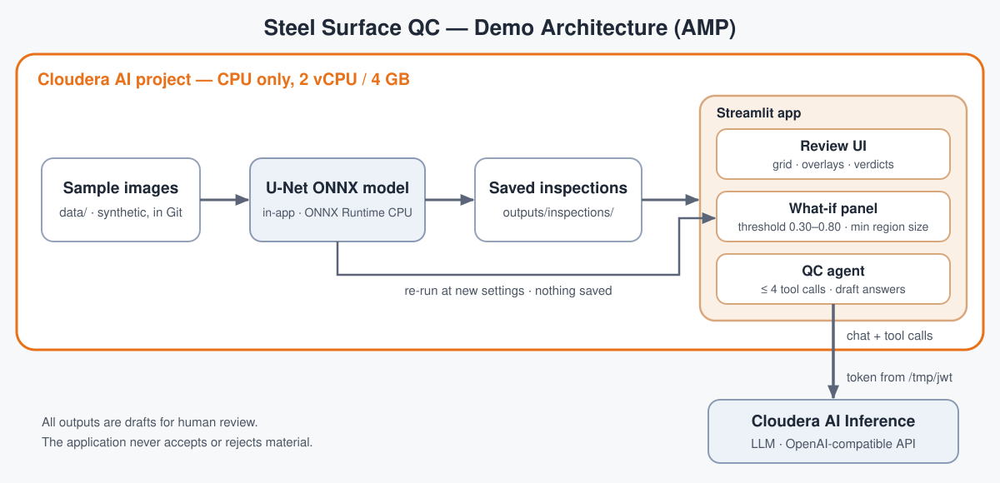

# Cloudera Blueprint: Steel Surface Defect Quality Control

## Table of Contents

- [Overview](#overview)
- [Demo](#demo)
- [Use Case](#use-case)
- [Key Features](#key-features)
- [Quickstart / Guide](#quickstart--guide)
- [Architecture / Software Components](#architecture--software-components)
- [Target Audience](#target-audience)
- [Repository Structure](#repository-structure)
- [Prerequisites](#prerequisites)
- [Hardware Requirements](#hardware-requirements)
- [Documentation](#documentation)

## Overview

Steel Surface QC is a Cloudera AI Applied ML Prototype (AMP) that inspects images of hot-rolled steel for six surface defect classes. A U-Net ONNX model runs inside the application on CPU and produces approximate defect masks. A Streamlit review interface lets an engineer browse results, record a verdict, and ask a tool-using QC agent questions about a saved inspection. The agent is backed by an LLM on Cloudera AI Inference. All outputs are drafts for human review; the application never accepts or rejects material.

## Demo

Reprise demo: TODO — not yet recorded.

## Use Case

Quality engineers who review steel surface images need a fast first pass that highlights where a defect may be and which of six classes it resembles, plus a way to ask questions about a result without leaving the review screen. This blueprint shows the pattern end-to-end: image, model inference, saved evidence, human review, and a constrained LLM agent that only reports what the saved inspection contains.

## Key Features

- One-click AMP: enter one value (the LLM endpoint URL) and four tasks install, download samples, run baseline inspections, and start the app.
- In-app ONNX inference: no model endpoint, no API key, no Model Registry. The model loads once and is reused.
- Review interface: grid of 29 sample inspections, overlays with per-class toggles, expected vs detected class, flags, and a verdict (agree, disagree, unsure) with notes.
- QC agent with strict controls: at most four tool calls, a fixed tool list, validated arguments, and answers labelled as drafts for human review.
- Graceful degradation: without an LLM endpoint the agent reports "LLM not configured" and the rest of the app keeps working.

Limitations: masks and areas are approximate (training masks came from bounding boxes); region counts are mask components, not confirmed defects; the model detects six classes only and is not general anomaly detection; no detection does not mean defect-free; defect handling guidance is draft only and hidden by default; every result needs human review.

## Quickstart / Guide

1. In Cloudera AI, create a new project from this repository as an AMP.
2. Enter `QC_LLM_BASE_URL`: the Cloudera AI Inference OpenAI-compatible base URL, ending in `/openai/v1`. Optionally set `QC_LLM_MODEL` (default `Qwen/Qwen2.5-7B-Instruct`).
3. Wait for the three tasks to finish: Install dependencies, Run baseline inspections, Steel Surface QC (the application).
4. Open the Steel Surface QC application.

Task details, environment variables and how to rerun are in [`deploy/README.md`](deploy/README.md).

## Architecture / Software Components

- **ONNX Runtime (CPU)** runs `model/Unet.onnx` (U-Net, ResNet34 encoder) inside the application process.
- **`src/`** holds preprocessing, inference, postprocessing, overlay rendering, the inspection pipeline, the review store, and the QC agent and its tools.
- **`outputs/inspections/`** stores each inspection (`result.json`, `overlay.jpg`, `masks.npz`, `reviews.jsonl`).
- **Streamlit application** (`app/review_app.py`) is the review interface and hosts the QC agent chat.
- **Cloudera AI Inference** serves the LLM that the agent calls through an OpenAI-compatible API. The token is read from the session file `/tmp/jwt`.

## Target Audience

- Solution architects and sales engineers demonstrating an image-inspection plus LLM-agent pattern on Cloudera AI
- ML and AI engineers who want a reference for running an ONNX model in-app with a constrained tool-calling agent
- Manufacturing quality engineers evaluating human-in-the-loop defect review

## Repository Structure

| Path | Description |
| --- | --- |
| `app/` | Streamlit review app (`review_app.py`) and its launcher (`start_app.py`) |
| `src/` | Inference, pre/postprocessing, inspection pipeline, review store, QC agent |
| `config/` | Class mapping and defect guidance |
| `model/` | `Unet.onnx` and the model card |
| `data/` | Synthetic sample images, stored in Git |
| `scripts/` | Baseline batch inspections and the sample image generator |
| `deploy/` | AMP install task and notes |
| `tests/` | Unit and model contract tests |
| `assets/` | Architecture diagram |
| `docs/` | User docs; `docs/dev-notes/` keeps development plans |
| `extras/model-endpoint/` | Optional CML Model endpoint and registry files, not used by the AMP |
| `METADATA.yaml` | Catalog metadata for the Cloudera blueprint website |
| `.project-metadata.yaml` | AMP definition |
| `THIRD_PARTY_NOTICES.md` | Provenance of the model and dataset |

## Prerequisites

- A Cloudera AI (Workbench) project that can be created from a Git repository
- A Cloudera AI Inference endpoint serving an OpenAI-compatible chat model with tool calling (for the QC agent only)

## Hardware Requirements

| Deployment | Minimum |
| --- | --- |
| Launchable / demo | 2 vCPU, 4 GB RAM, CPU only, about 1 GB free disk (per `.project-metadata.yaml`) |
| Production / enterprise | TODO — not sized; this is a demonstration and not validated for production use |

## Documentation

- [`deploy/README.md`](deploy/README.md) — the three AMP tasks, environment variables, rerunning
- [`docs/review-ui.md`](docs/review-ui.md) — the review application
- [`docs/step1-validation.md`](docs/step1-validation.md) — model validation and baseline
- [`model/README.md`](model/README.md) — model card
- [`data/README.md`](data/README.md) — the synthetic sample images and how they are made
- [`extras/model-endpoint/README.md`](extras/model-endpoint/README.md) — optional endpoint and registry files
- [`THIRD_PARTY_NOTICES.md`](THIRD_PARTY_NOTICES.md) — provenance and licence status
